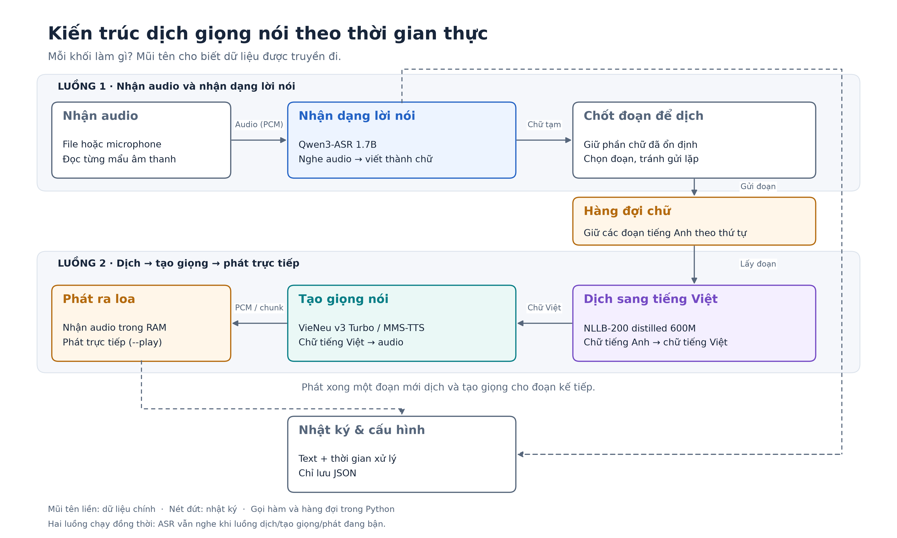

# translate-video

A Python prototype for streaming speech translation. The default direction is
**English → Vietnamese**, using a fixed synthetic voice.

See [CHANGELOG.md](CHANGELOG.md) for development changes and validation status.

```text
Microphone / audio-file replay (100 ms frames, 16 kHz mono)
    → Qwen3-ASR-1.7B streaming through vLLM
    → stable transcript segmentation + silence/window finalization
    → NLLB-200 distilled 600M
    → VieNeu-TTS-v3-Turbo streaming (or MMS-TTS baseline)
    → optional direct speaker playback (audio stays in memory)
```

This is an experiment, not a production dubbing service. It does not clone
voices, synchronize video, separate speakers, or preserve background music.
FastSpeech 2 and Nemotron are not implemented in this version. VieNeu emits
48 kHz audio chunks through a single playback stream. MMS-TTS remains available
as a 16 kHz, whole-waveform baseline.



The diagram is generated with Matplotlib. To regenerate the PNG and SVG:

```bash
.venv/bin/python -m pip install -e '.[plot]'
.venv/bin/python scripts/draw_architecture.py
```

## Installation

Use Linux, Python **3.12**, an NVIDIA CUDA GPU, and sufficient disk space for
PyTorch, vLLM, CUDA libraries, and model weights. A 12 GB GPU is the experiment's
target, not a guaranteed minimum. Qwen's upstream package pins
`transformers==4.57.6` and `vllm==0.14.0`; use an isolated environment.
Triton also requires a C compiler and headers for your Python interpreter, even
when CUDA graph capture is disabled.

```bash
python3.12 -m venv .venv
mkdir -p .cache/pip-tmp
TMPDIR="$PWD/.cache/pip-tmp" .venv/bin/python -m pip install -e '.[dev,vieneu]'
```

The explicit temporary directory avoids filling a RAM-backed `/tmp` with large
CUDA wheels. Ensure this directory and the model cache have enough disk space.

If the machine has no system compiler, an optional local compiler is available:

```bash
TMPDIR="$PWD/.cache/pip-tmp" .venv/bin/python -m pip install -e '.[dev,compiler,vieneu]'
export CC="$PWD/scripts/zig-cc"
```

The compiler wrapper uses this checkout's `.venv`; keep that environment at the
documented location. A normal GCC/Clang installation can be used instead.

For the exact library versions used in the recorded Linux/Python 3.12 experiment,
install `requirements-tested.txt` first, then install this project with
`pip install --no-deps -e .`. The version snapshot includes the optional compiler.
For VieNeu, also install `pip install -e '.[vieneu]'`. This installs the core SDK
without its CUDA extra, preserving vLLM's PyTorch 2.9.1. The SDK's CUDA extra
pins PyTorch 2.8.0 and conflicts with vLLM 0.14.0; do not install that extra into
this environment. The core SDK's GPU backend was tested here with PyTorch 2.9.1.

Microphone capture requires PortAudio. If importing `sounddevice`
reports a missing library, install your distribution's PortAudio runtime
(for example, `libportaudio2` on Ubuntu). Playback first uses `pw-play` (PipeWire)
or `aplay` (ALSA) if available, and otherwise uses `sounddevice` with PortAudio.
File replay with PipeWire playback works without PortAudio. Native players
receive raw PCM on stdin; no intermediate audio files are written.

## Try an audio file

Download the public English audio used by Qwen's official streaming example:

```bash
mkdir -p examples
curl -fL https://qianwen-res.oss-cn-beijing.aliyuncs.com/Qwen3-ASR-Repo/asr_en.wav \
  -o examples/asr_en.wav

.venv/bin/translate-video \
  --input examples/asr_en.wav \
  --realtime \
  --output output/english-to-vietnamese
```

By default, a punctuation boundary must agree across consecutive ASR decode
results, or stable text must reach 24 whitespace-separated words. This heuristic
reduces revisions but does not guarantee semantic correctness. Add `--final-only`
for conservative commits at silence/window finalization; this can delay the
first audio until the entire window finishes.

Add `--play` to hear the translated voice. Without it, the generated waveform is
discarded after its text and timing metrics are recorded. Audio is never saved.
Each run needs a new directory for JSON logs and configuration.
The initial model download and loading time are excluded from processing metrics.

For the prepared ten-second sample, play Vietnamese speech as segments become
available:

```bash
CC="$PWD/scripts/zig-cc" HF_HUB_OFFLINE=1 \
.venv/bin/translate-video \
  --input examples/english_10s.wav \
  --realtime --play \
  --output "output/live-$(date +%Y%m%d-%H%M%S)"
```

Use this offline command after the models have been downloaded. `--realtime`
paces input processing; `--play` plays the translated speech. The English source
is not played simultaneously. Wait for model loading to finish before expecting
speech. For an English preview, run `pw-play examples/english_10s.wav` separately.

For microphone input:

```bash
.venv/bin/translate-video --mic --play --output output/microphone
```

Press Ctrl+C once to finalize pending speech and drain the workers. Avoid feeding
speaker output back into the microphone; headphones are useful for this test.
You can select an input device with `--mic-device`.

For a different direction, change all three language settings together and
select a matching TTS checkpoint. For example, Vietnamese → English:

```bash
.venv/bin/translate-video --input examples/vietnamese.wav \
  --source-language Vietnamese --source-code vie_Latn --target-code eng_Latn \
  --tts-backend mms --tts-model facebook/mms-tts-eng --realtime \
  --output output/vietnamese-to-english
```

## Outputs and metrics

VieNeu is the default TTS backend. Use `--tts-backend mms` for the previous
baseline, or `--tts-voice 'Mai Anh'` to choose a VieNeu preset. The resolved
default voice in SDK 3.8.3 for this experiment was `Hải Đăng`.

```bash
CC="$PWD/scripts/zig-cc" HF_HUB_OFFLINE=1 .venv/bin/translate-video \
  --input examples/english_10s.wav --realtime --play \
  --tts-backend vieneu --output output/live-vieneu
```

The first run must have internet access to download VieNeu and its MOSS codec;
omit `HF_HUB_OFFLINE=1` until those artifacts are cached. Choose a new output
directory for each run.

Each output directory contains:

- `events.jsonl`: partial transcripts, translation text, stage timings, and a
  final summary on successful completion.
- `configuration.json`: command arguments, core library versions, and GPU name.

The timings separate translation queue wait, translation inference, TTS
inference, and blocking playback duration (`playback_ms`, when `--play` is used).
`--output` selects a log directory; it does not save audio. There is no audio
queue or audio-queue timing in new runs. `commit_to_audio_ready_ms` starts **after**
segmentation: it excludes time spent listening and stabilizing ASR.
`source_observed_end_seconds` is the audio cursor at commit, not a word timestamp.
This version therefore does not report precise source-word-to-speaker latency.
`audio_ready_elapsed_seconds` starts at input processing and records when a
segment waveform is ready. The report includes this value for the first segment;
it excludes model startup and does not represent delay for every source word.
For VieNeu, `tts_first_chunk_ms` measures first-chunk availability, and
`first_audio_ready_elapsed_seconds` is the corresponding input-relative time.
`audio_ready_elapsed_seconds` means the final chunk has arrived.
`tts_stream_elapsed_ms` spans generation through the last chunk and may include
player backpressure. Streaming generation and `playback_ms` overlap; do not add
them together. Isolated generation speed is measured by the benchmark below.
`asr_call_ms` measures a decode-triggering call; it excludes earlier buffering.
File replay without `--realtime` is a throughput experiment, not a live-latency
measurement. The summary's wall time includes draining and playback, if enabled.

Summarize median and p95 timings with:

```bash
.venv/bin/python -m translate_video.report output/english-to-vietnamese/events.jsonl
```

## Important behavior

- RMS energy is a simple silence heuristic, not a trained VAD. Quiet speech can
  be missed; noise can prevent silence detection. Adjust `--rms-threshold`.
- Silence of 0.6 seconds finalizes a window. A window is also finalized after
  12 seconds to bound Qwen's accumulating audio context. Forced boundaries can
  split a sentence and reduce translation quality. The ASR context is capped at
  1024 tokens to keep the single-stream configuration within the GPU budget;
  substantially longer windows may exceed it.
- Qwen partial text may change. If it revises an already committed prefix, the
  run stops explicitly rather than duplicating or silently skipping speech.
  Retry with `--final-only` or a longer `--chunk-seconds` value.
- Translation uses each committed segment independently; it has no rolling
  discourse context. Pronouns and incomplete clauses can translate poorly.
- ASR runs independently of a single translation/TTS/playback worker, connected
  by a bounded text queue. The worker translates, synthesizes, and plays one
  segment completely before starting the next. There is no audio-output worker
  or audio queue.
  Microphone overflow or a full translation queue stops the run explicitly.
  There is no automatic speech-rate adaptation: longer translations can still
  accumulate playback delay.
- MMS generates a full segment before playback. Streaming ASR does not make
  this TTS implementation streaming.
- VieNeu sends chunks to one PCM player per segment. The application has no
  audio-output queue and saves no waveforms; the SDK scheduler and the audio
  device still use their own internal buffers.
- On failure, output files may contain a partial run. Preserve them for diagnosis
  and choose another output directory before retrying.

## Validation

```bash
.venv/bin/python -m pytest
```

Tests cover transcript revision, duplicate prevention, final flushing, bounded
segments, worker failures, text queue draining, direct PCM playback, the absence
of saved audio, report compatibility, and audio resampling. They use fake
model adapters and do **not** prove model quality or GPU performance.

See [the feasibility and evaluation notes](docs/feasibility.md) and
[the experiment report](docs/experiment.md) for model decisions and actual
validation results.

See [the TTS speed comparison](docs/tts-benchmark.md) for matched-text GPU
measurements. Reproduce it without playback or saved audio:

```bash
.venv/bin/python scripts/benchmark_tts.py --backend mms --output output/bench-mms.json
.venv/bin/python scripts/benchmark_tts.py --backend vieneu --output output/bench-vieneu.json
```

Run the commands sequentially with other GPU inference stopped. Each command
uses six identical texts, five repetitions per text, and three warmup requests.

## Model references and licenses

- [Qwen3-ASR](https://github.com/QwenLM/Qwen3-ASR): streaming API and examples.
- [NLLB-600M](https://huggingface.co/facebook/nllb-200-distilled-600M):
  research model; CC-BY-NC-4.0; not released for production deployment.
- [Vietnamese MMS-TTS](https://huggingface.co/facebook/mms-tts-vie):
  Vietnamese VITS checkpoint; CC-BY-NC-4.0.
- [VieNeu-TTS-v3-Turbo](https://huggingface.co/pnnbao-ump/VieNeu-TTS-v3-Turbo):
  Vietnamese/English streaming TTS; Apache-2.0.
- [alVoCat Vocos](https://huggingface.co/projecte-aina/alvocat-vocos-22khz):
  Catalan-trained vocoder; not used in this prototype.

Model licenses are separate from application code. This stack is intended for
non-commercial evaluation.
