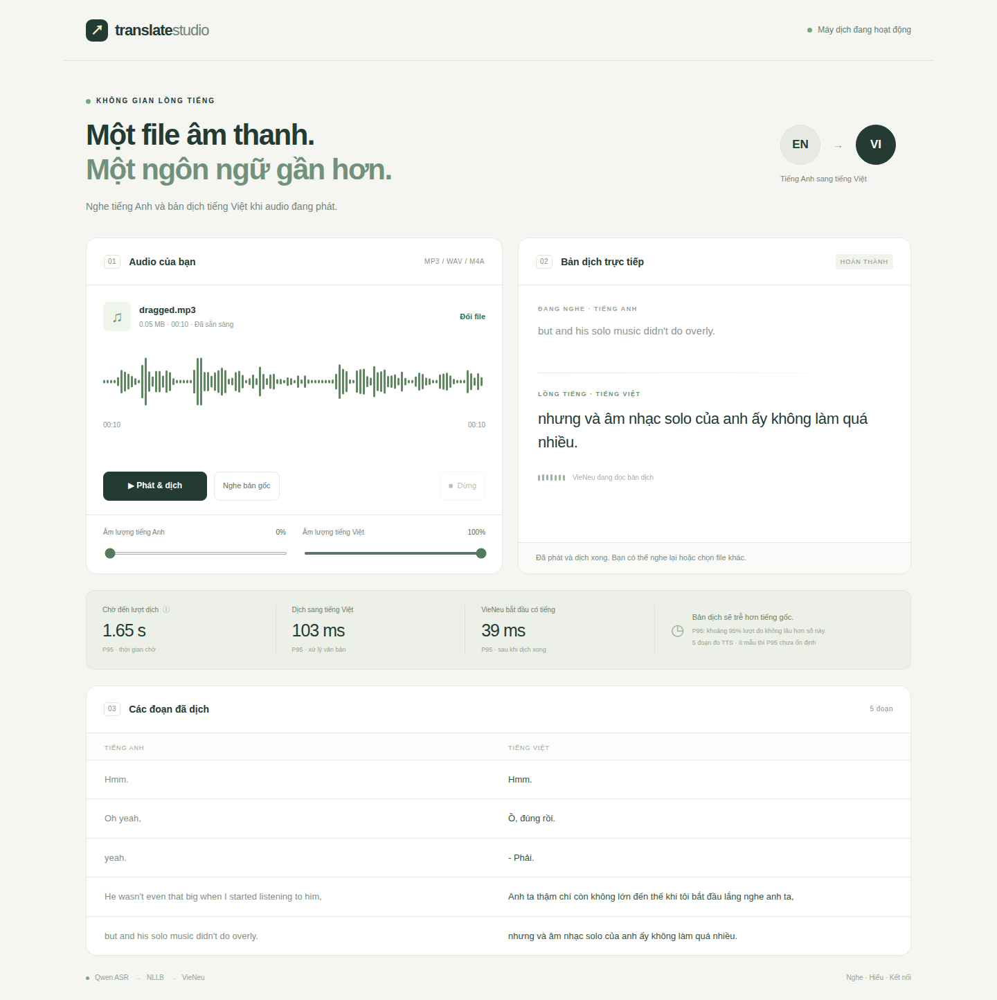

# Use the web app

## Start

To run in the background:

```bash
./start-backend.sh
```

You can close the terminal. To stop the backend later:

```bash
./stop-backend.sh
```

Logs are in `output/backend/backend.log`. The scripts work from any directory,
avoid starting a duplicate backend, and stop only the process they started.
Stopping can take up to 30 seconds while a model is loading.

From the project folder, with the existing Python 3.12 environment:

```bash
.venv/bin/python -m pip install -e '.[web,vieneu]'
.venv/bin/python -m translate_video.web
```

Open **http://127.0.0.1:8000** in Chrome, Edge, or Firefox.
The server uses the local GPU and selects the project's Zig compiler wrapper
when it is available. Keep the terminal running while you use the page.
Press Ctrl+C in the terminal to stop the server.



## Translate a file

1. Drag an MP3 onto the page, or click the file area to choose one.
2. Wait for **Model đã sẵn sàng** in the top-right corner, then click **Phát & dịch**.
3. Listen to the English file and the Vietnamese voice. Adjust their volumes
   separately; set English to 0% to hear only Vietnamese.
4. Use **Tạm dừng** to pause both voices, or **Dừng** to cancel the session.

**Nghe bản gốc** plays the file without starting the translation models.
**Dùng audio mẫu 10 giây** uses `examples/english_10s.wav` if that file is installed.

The app accepts browser-decodable MP3, WAV, and M4A files, up to 30 MB and
10 minutes. It starts each translation session from the beginning. Seeking
inside a running session is not supported.

The app first processes a short part of the file, then starts both voices when
the first Vietnamese audio arrives. During playback, it reads up to five
seconds ahead. This is possible because the MP3 is already on your computer;
it cannot work the same way with a live microphone. There is still a short
preparation delay, and the two languages can drift because speaking rates differ.
If no translated audio arrives within two seconds, the original starts anyway
so silence or slow processing does not leave playback stuck.

## Why is the Vietnamese voice delayed?

Qwen first needs enough audio to recognize stable English words. NLLB translates
those words, then VieNeu starts speaking. The worker finishes speaking one
segment before translating the next, so later text may wait for its turn.
After the short preparation step, the English file plays at normal speed.

The web app loads and warms the models when the server starts. During playback,
ASR updates every 0.5 seconds. Stable text is sent to translation at punctuation
or after eight words, rather than waiting for the former 24-word limit. This
lets long sentences start speaking sooner, but short fragments can translate
less naturally. The last three words remain editable until more speech arrives
or the ASR window ends; this helps avoid speaking a sentence ending that ASR
later changes. CLI runs retain their previous segmentation settings.

**Tạm dừng** freezes both audio tracks. Already received text may still update
while the GPU finishes its current work. After the source file ends, the app
continues reading the remaining Vietnamese segments.

## Read the three P95 numbers

- **Chờ đến lượt dịch:** text waiting while the previous segment is handled.
- **Dịch sang tiếng Việt:** time NLLB spends translating text.
- **VieNeu bắt đầu có tiếng:** time after translation until the first audio
  chunk is available. This excludes the earlier ASR and text-queue waits.

P95 means about 95% of measurements are no larger than the displayed number.
The page shows how many TTS segments have been measured. A short file produces
few measurements, so its P95 is only a quick observation, not a reliable
long-session benchmark. See [the timing guide](latency.md) for examples.
These times do not measure the exact delay at the physical speaker.

## Files and connections

The browser opens and decodes your file locally. It sends short, mono 16 kHz
audio frames over a WebSocket, reading ahead of playback. Python acknowledges
processed frames, limiting unprocessed input to four seconds. Python runs Qwen, NLLB,
and VieNeu, then sends 48 kHz audio chunks and text back to the browser.
No source or translated audio files are saved by this app. JSON text and timing
logs are written under `output/web/`.

There is no application audio-output queue. The browser schedules a small
amount of received audio for smooth playback; playback acknowledgements limit
how far the server can send ahead. Only one translation session uses the GPU
at a time. Keep the tab visible: a sleeping/background tab can interrupt the
real-time input clock. The app stops if input falls more than five seconds behind.

## If it does not work

- **Models are downloading:** wait, and keep internet access enabled. Set
  `HF_HUB_OFFLINE=1` only after all models are cached.
- **No sound:** check both volume sliders and the computer's sound output.
- **Another session is active:** stop it or close its tab, then retry. If you
  cancel while models are loading, wait for that loading step to finish.
  The app waits for the previous session to release the GPU before starting.
- **Audio cannot be read:** try another MP3 or WAV. Codec support depends on
  the browser.
- **The port is in use:** start with `--port 8001` and open that port instead.

For developers, the WebSocket implementation follows
[FastAPI's WebSocket API](https://fastapi.tiangolo.com/advanced/websockets/).
File decoding uses the browser's
[decodeAudioData API](https://developer.mozilla.org/en-US/docs/Web/API/BaseAudioContext/decodeAudioData).

## Validation

The web app completed a real 10-second MP3 test through Qwen, NLLB, and VieNeu
on the RTX 4070 SUPER. Chromium received and played five translated segments.
Original playback, pause/resume, and the mobile layout were also checked.
Dragging an MP3 onto the page, stopping during speech, and starting a fresh
session afterward were verified in the browser.
The run created only JSON logs. There were no browser JavaScript errors.
The 30 automated tests include WebSocket audio, subtitles, disconnection,
exclusive GPU sessions, and invalid-input handling. Physical speaker latency
and long sessions remain unmeasured.

Before adding read-ahead, five starts of `ENG_US_M_DaveL.mp3` measured
**P95 = 4.11 seconds from clicking Play to the first scheduled Vietnamese audio**.
Models were already loaded and warm. Four trials stopped after the first audio;
the fifth completed the entire 19.9-second file without a browser error.
These five trials are a small check, not a long-session benchmark or a physical
speaker measurement. [Raw timings](results/web-first-audio.json).

With five-second read-ahead and the short preparation step, the same test
measured **P95 = 0.93 seconds** over five starts. This is recorded-file startup
latency with warm models, not live microphone latency. The last run completed
the full file. [Read-ahead timings](results/web-prefetch-first-audio.json).
